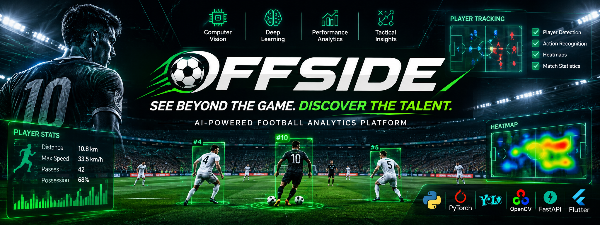
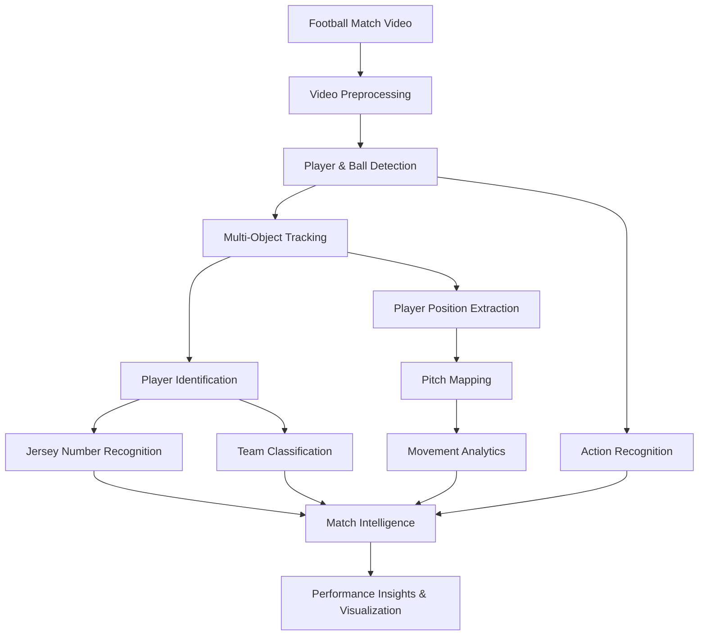

<div align="center">
  
</div>

<h1 align="center">⚽ OffSide — AI Football Analytics</h1>

<p align="center">
  <strong>See Beyond the Game. Discover the Talent.</strong>
</p>

<p align="center">
  An AI-powered football analytics platform designed to bring professional-level performance analysis to grassroots, amateur, and 5-a-side football.
</p>

<p align="center">
  
  
  
  
  
</p>

---

## 📌 Overview

**OffSide** is an AI-powered football analysis system that transforms ordinary match recordings into meaningful football performance insights.

Using Computer Vision and Deep Learning, the platform analyzes match footage to detect and track players, recognize football actions, identify player jerseys, and generate performance statistics.

The goal is simple:

**Make football analytics accessible to every player — not just professional clubs.**

Traditional football analytics systems often depend on expensive GPS trackers, wearable sensors, and specialized equipment. OffSide explores a more accessible alternative: using a standard camera recording as the primary input.

---

## 🎯 The Problem

Thousands of talented football players participate in grassroots leagues, amateur tournaments, and 5-a-side matches.

However, many of them lack access to:

- Professional performance analysis.
- Reliable and documented player statistics.
- Objective performance evaluation.
- Visibility to scouts and football organizations.
- Affordable football analytics technology.

As a result, talented players may remain undiscovered simply because their performance is not documented.

### 💡 Our Solution

OffSide aims to bridge this gap by converting match videos into structured football data.

Instead of relying on expensive hardware, the system uses AI models to extract insights directly from video footage.

---

## 🚀 Key Features

### 1. Player and Ball Detection

- Detect football players and the ball from match footage.
- Identify relevant objects in each video frame.
- Provide detection information for downstream tracking and analysis.

### 2. Multi-Object Tracking

- Maintain player identities across consecutive frames.
- Track player movement throughout the match.
- Reduce identity switches using object tracking techniques.

### 3. Jersey Number Recognition

- Detect jersey regions.
- Recognize visible player numbers.
- Associate recognized numbers with tracked players whenever possible.

### 4. Team Classification

- Analyze player appearance and jersey colors.
- Use color-based classification techniques.
- Assign players to their corresponding teams.

### 5. Football Pitch Mapping

- Map player positions onto a tactical pitch representation.
- Visualize player positioning and movement.
- Support spatial analysis of match performance.

### 6. Player Performance Analytics

Generate visual insights and statistics such as:

- Player movement.
- Distance covered.
- Speed estimation.
- Heatmaps.
- Team positioning.
- Possession-related analysis.

*The availability and accuracy of individual metrics depend on the implemented pipeline and video calibration.*

### 7. Football Action Recognition

The project explores video-based action recognition using deep learning.

The action classes include:

| Action | Description |
|---|---|
| PASS | Passing the ball |
| HIGH_PASS | High ball pass |
| SHOT | Shooting attempt |
| HEADER | Heading the ball |
| CROSS | Crossing the ball |
| THROW_IN | Throw-in |
| OUT | Ball out of play |
| PLAYER_SUCCESSFUL_TACKLE | Successful tackle |
| BALL_PLAYER_BLOCK | Ball-player blocking event |

### 8. Match Intelligence

The extracted information can support:

- Player performance evaluation.
- Match statistics.
- Tactical analysis.
- Player comparison.
- Scouting and talent discovery.

---

## 🧠 System Architecture

The overall processing workflow follows this structure:



### Processing Pipeline

1. **Input:** Football match recording.
2. **Preprocessing:** Frame extraction and video preparation.
3. **Detection:** Identify players and the ball.
4. **Tracking:** Maintain object identities across frames.
5. **Identification:** Extract jersey numbers and classify teams.
6. **Spatial Analysis:** Estimate player positions and map them onto the pitch.
7. **Action Recognition:** Classify football-related actions.
8. **Analytics:** Generate performance insights and visualizations.

---

## 🛠️ Technology Stack

| Category | Technologies |
|---|---|
| Programming Language | Python |
| Deep Learning | PyTorch |
| Object Detection | YOLO |
| Computer Vision | OpenCV |
| Object Tracking | ByteTrack / Tracking Algorithms |
| Player Recognition | CNN / ResNet-based Models |
| Action Recognition | R3D-18 |
| Data Processing | NumPy, Pandas |
| Visualization | Matplotlib, OpenCV |
| Backend / Integration | FastAPI |
| Mobile Application | Flutter |
| Cloud / Database Integration | Supabase |

*The technologies listed represent the project's technology stack and integration direction; not every component is necessarily part of the currently executable video pipeline.*

---

## 🔬 Computer Vision & Deep Learning

### Object Detection

The detection stage identifies football-related objects in individual frames.

YOLO-based detection is used to locate objects through bounding boxes.

Each detection can be represented as:

```text
Detection = {
    class_id,
    confidence,
    bounding_box
}
```

### Multi-Object Tracking

Tracking associates detections across frames to maintain consistent object identities.

This allows the system to estimate player movement and follow individuals throughout a match.

### Jersey Number Recognition

A dedicated recognition stage analyzes player jersey regions to extract visible numbers.

The recognition output can help connect tracked players with their registered identities.

### Team Classification

Player jersey colors can be analyzed using HSV color representations.

This supports grouping players into teams based on their visual appearance.

### Action Recognition

The project explores 3D Convolutional Neural Networks for recognizing football actions from video clips.

The R3D-18 architecture processes spatial and temporal information to learn motion-related features.

---

## 📂 Project Structure

```text
AI-Football-Analysis/
│
├── assets/
│   └── offside-banner.png
│
├── data/
│   └── ...
│
├── notebooks/
│   └── ...
│
├── scratch/
│   └── ...
│
├── src/
│   └── ...
│
├── pipeline.py
├── create_colab_package.py
├── graduation_project_book.md
├── graduation_thesis_content.md
├── source.txt
├── .gitignore
└── README.md
```

---

## ⚙️ Getting Started

### Prerequisites

- Python 3.10 or later.
- Git.
- A compatible environment for PyTorch.
- GPU acceleration is recommended for computationally intensive video analysis.

### 1. Clone the Repository

```bash
git clone https://github.com/nabilamir1/AI-Football-Analysis.git
```

### 2. Navigate to the Project

```bash
cd AI-Football-Analysis
```

### 3. Create a Virtual Environment

```bash
python -m venv venv
```

Activate it:

**Windows:**

```bash
venv\Scripts\activate
```

**Linux / macOS:**

```bash
source venv/bin/activate
```

### 4. Install Dependencies

Install the core packages:

```bash
pip install torch torchvision
pip install opencv-python numpy pandas ultralytics
```

Additional dependencies may be required depending on the specific modules being executed.

### 5. Configure Model Weights and Input Data

Before running the pipeline:

- Place the required input video in the expected data directory.
- Ensure the required trained model weights are available.
- Verify model paths and configuration settings.
- Install any additional dependencies required by the selected modules.

### 6. Run the Pipeline

```bash
python pipeline.py
```

**Note:** Exact execution requirements depend on the model checkpoints, input video paths, and configuration used by the current implementation.

---

## 📊 Expected Outputs

The analysis pipeline is designed to produce information that can support:

| Output | Purpose |
|---|---|
| Player Detection | Locate players in match frames |
| Ball Detection | Locate the football |
| Player Tracking | Maintain player identities |
| Jersey Recognition | Extract player numbers |
| Team Classification | Identify team membership |
| Pitch Mapping | Visualize spatial positioning |
| Heatmaps | Analyze player movement patterns |
| Speed Estimation | Estimate movement speed |
| Distance Covered | Analyze player movement |
| Action Recognition | Identify football-related actions |

---

## 🌍 Impact & Vision

### Democratizing Football Analytics

Professional football clubs have access to advanced tracking systems, specialized cameras, and dedicated analytics teams.

Grassroots players often do not.

OffSide aims to make performance analysis more accessible by using existing match recordings and AI-based computer vision techniques.

Our vision is to help:

- **Players:** Understand their performance and track their development.
- **Organizers:** Manage tournaments and improve match documentation.
- **Scouts:** Discover promising players through measurable performance data.

**Talent should not remain invisible because data is unavailable.**

---

## 🔮 Future Improvements

Potential future development directions include:

- Real-time match analysis.
- Improved player re-identification.
- More robust jersey number recognition.
- Advanced ball tracking.
- Automated event detection and match statistics.
- Tactical formation analysis.
- Player comparison dashboards.
- Scout-oriented player discovery.
- Improved referee-assistance capabilities.
- Mobile application integration.
- Cloud-based match management and player profiles.

---

## 🎓 Academic Context

OffSide is a graduation project developed as an exploration of Artificial Intelligence, Computer Vision, and Deep Learning applied to football analytics.

The project focuses on applying modern AI techniques to a real-world problem: making football performance data more accessible to grassroots players and amateur competitions.

**Project:** OffSide — AI Football Analytics  
**Academic Year:** 2025–2026  
**Field:** Artificial Intelligence & Computer Vision

---

## 👨‍💻 Contributors

Developed as a collaborative graduation project.

---

<div align="center">

### ⚽ OFFSIDE

**SEE BEYOND THE GAME. DISCOVER THE TALENT.**

*Turning football footage into meaningful intelligence.*

</div>
