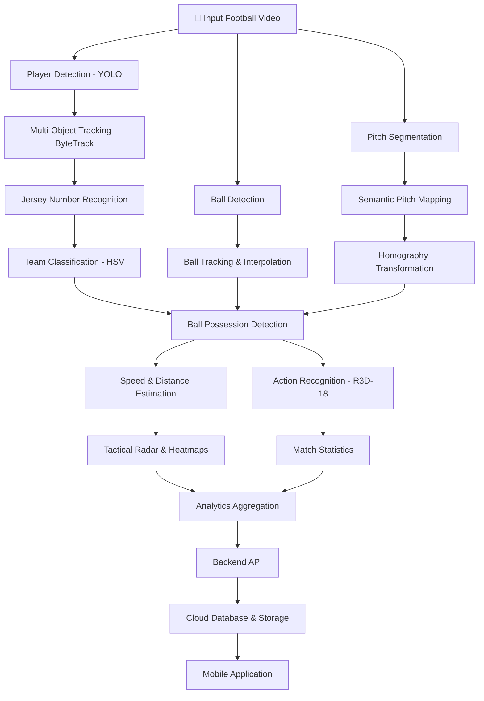

<div align="center">

# ⚽ OffSide
### AI-Powered Football Match Analysis & Performance Intelligence

**Turning Football Footage into Actionable Performance Insights.**

[](https://www.python.org/)
[](https://pytorch.org/)
[](https://www.ultralytics.com/)
[](https://opencv.org/)
[](https://fastapi.tiangolo.com/)
[](https://flutter.dev/)

**Graduation Project | Computer Science & Artificial Intelligence**

</div>

---

## 🚀 Overview

**OffSide** is an AI-powered football analytics platform designed to make professional-level football performance analysis more accessible, particularly for grassroots football, amateur leagues, and 5-a-side tournaments.

Traditional football analytics often depend on expensive tracking equipment, specialized infrastructure, and dedicated analysis teams. This makes advanced performance insights difficult to access for smaller clubs and talented players outside professional academies.

OffSide addresses this challenge by transforming ordinary football match footage into meaningful performance data using **Computer Vision, Deep Learning, and Intelligent Analytics**.

Using a standard camera recording, the system analyzes match footage, detects and tracks players and the ball, recognizes football actions, calculates player performance metrics, and generates visual insights.

> **Our Vision:** Democratizing football analytics and giving every talented player the opportunity to be seen through data, not just exposure.

---

## 🎯 The Problem We're Solving

Football talent exists everywhere, but access to professional performance analytics does not.

- **Limited Visibility:** Talented amateur players often remain undiscovered due to a lack of reliable performance records.
- **Expensive Infrastructure:** Traditional tracking systems require specialized hardware and expensive equipment.
- **Manual Analysis:** Recording match statistics manually is time-consuming and prone to human error.
- **Data Accessibility:** Small clubs and grassroots tournaments lack affordable tools to evaluate player performance.

### 💡 Our Approach

OffSide uses AI-powered video analysis to turn a regular football recording into structured performance insights, helping players, organizers, coaches, and scouts make better-informed decisions.

---

## ✨ Key Features

### 🎯 1. Player & Ball Detection
- AI-based player and ball detection using YOLO.
- Identification of players, referees, and football objects.
- Frame-by-frame visual detection and localization.

### 🔄 2. Multi-Object Tracking
- Player tracking using ByteTrack.
- Consistent player ID assignment across video frames.
- Ball trajectory tracking.
- Handling temporary ball occlusions through motion-based interpolation.

### 👕 3. Jersey Number Recognition
- Automated jersey number recognition.
- Multi-frame voting to improve recognition consistency.
- Linking player identities with their match statistics.

### 🏳️ 4. Team Classification
- Automatic team assignment based on jersey colors.
- HSV color-space analysis.
- Team-level performance aggregation.

### 🗺️ 5. Tactical Radar & Pitch Mapping
- Transformation of video coordinates into pitch coordinates.
- Homography-based perspective transformation.
- Semantic camera movement compensation.
- 2D tactical radar visualization.
- Individual player heatmaps.

### 🏃 6. Player Performance Analytics
- Total distance covered.
- Average and maximum speed.
- Player movement analysis.
- Ball possession tracking.
- Individual and team performance statistics.

### ⚡ 7. Football Action Recognition
Powered by a 3D Convolutional Neural Network (**R3D-18**).

The system analyzes temporal video sequences to recognize football actions, including:

- Passes
- High Passes
- Shots
- Headers
- Crosses
- Throw-ins

### 📊 8. Match Intelligence
- Automated match statistics generation.
- Player-level performance insights.
- Team-level performance summaries.
- Structured analytics output.

---

## 🧠 System Architecture

OffSide follows a multi-stage AI processing pipeline that transforms raw football footage into structured match analytics.



---

## 🛠️ Technology Stack

| Category | Technologies |
|---|---|
| Programming Language | Python |
| Computer Vision | OpenCV |
| Object Detection | Ultralytics YOLO |
| Object Tracking | ByteTrack |
| Deep Learning | PyTorch |
| Action Recognition | R3D-18 |
| Image Processing | NumPy, OpenCV |
| Team Classification | HSV Color Space |
| Player Mapping | Homography Transformation |
| Backend | FastAPI |
| Database & Cloud | Supabase |
| Mobile Development | Flutter, Dart |

---

## 🔬 Core AI & Computer Vision Techniques

OffSide integrates several computer vision and deep learning techniques to overcome the challenges of analyzing dynamic football footage.

| Technique | Purpose |
|---|---|
| YOLO | Real-time object detection |
| ByteTrack | Multi-object tracking |
| HSV Classification | Team identification |
| Homography | Perspective transformation |
| Optical/Semantic Camera Compensation | Stabilizing pitch mapping under camera movement |
| Motion Interpolation | Estimating temporarily missing ball positions |
| R3D-18 | Temporal football action recognition |
| Heatmap Generation | Visualizing player movement patterns |

### Player Movement Estimation

Player positions are transformed into pitch coordinates to estimate their movement in real-world space.

The Euclidean distance between consecutive positions is calculated as:

\[
d(t)=\sqrt{(x_t-x_{t-1})^2+(y_t-y_{t-1})^2}
\]

Total distance:

\[
D_{total}=\sum_{t=1}^{T}d(t)
\]

Instantaneous speed:

\[
v(t)=d(t)\times FPS
\]

This allows the system to generate meaningful movement metrics instead of relying only on raw pixel coordinates.

---

## 📈 Action Recognition Model

OffSide uses **R3D-18**, a 3D Convolutional Neural Network, to recognize football actions from temporal video sequences.

Unlike conventional image classification, 3D CNNs learn both spatial and temporal information, making them suitable for recognizing actions that develop across multiple frames.

### Recognized Actions

| Action | Description |
|---|---|
| PASS | Passing the ball |
| HIGH_PASS | High aerial pass |
| SHOT | Attempt to score |
| HEADER | Heading the ball |
| CROSS | Delivering the ball into a dangerous area |
| THROW_IN | Throw-in situation |

The model was trained using video augmentation techniques to improve generalization and address limited training data.

---

## 📂 Repository Structure

```text
OffSide/
│
├── data/
│   └── Training and project data
│
├── notebooks/
│   └── Model experiments and development notebooks
│
├── scratch/
│   └── Experimental implementations
│
├── src/
│   └── Core source modules
│
├── pipeline.py
│   └── Main football analysis pipeline
│
├── create_colab_package.py
│   └── Google Colab packaging utility
│
├── graduation_project_book.md
│   └── Graduation project technical documentation
│
├── graduation_thesis_content.md
│   └── Research and thesis documentation
│
└── README.md
```

---

## ⚙️ Getting Started

### Prerequisites

- Python 3.10+
- Git
- Google Colab or a local Python environment
- CUDA-compatible GPU recommended for deep learning workloads.

### 1. Clone the Repository

```bash
git clone https://github.com/nabilamir1/AI-Football-Analysis.git

cd AI-Football-Analysis
```

### 2. Set Up a Virtual Environment

```bash
python -m venv venv
```

Activate it:

**Windows:**
```bash
venv\Scripts\activate
```

**Linux / macOS:**
```bash
source venv/bin/activate
```

### 3. Install Dependencies

Install the Python dependencies required by the project modules and notebooks.

```bash
pip install torch torchvision opencv-python numpy pandas ultralytics
```

Additional dependencies may be required depending on the selected module and execution environment.

### 4. Run the Analysis Pipeline

The main processing entry point is:

```bash
python pipeline.py
```

**Note:** Configure the required model weights, input video paths, and project settings according to the pipeline configuration before execution. The complete application and cloud integration may require additional setup.

---

## 🎓 Project Scope & Academic Context

OffSide was developed as a **Computer Science & Artificial Intelligence Graduation Project**.

The project explores the practical integration of:

- Computer Vision
- Deep Learning
- Object Detection & Tracking
- Video Understanding
- Sports Performance Analytics
- AI-powered Applications
- Cloud-based Data Management

The project was also presented at the **Smart Innovation Exhibition**, associated with **IEEE ICMISI 2026 at AASTMT**.

---

## 🌍 Our Impact

OffSide is built around a simple idea:

**Talent should never be limited by the lack of data.**

By making football analytics more accessible, we aim to help:

- **Players:** Build measurable performance profiles and track their development.
- **Organizers:** Gain structured match statistics and reduce dependence on manual recording.
- **Scouts:** Discover promising players through objective performance indicators.
- **Coaches:** Understand player movement and team performance through visual analytics.

Our long-term goal is to help bridge the gap between grassroots football and professional-level performance analysis.

---

## 🔮 Future Improvements

- Improved player re-identification across longer sequences.
- More advanced football event detection.
- Enhanced real-time processing performance.
- Expanded tactical and statistical analysis.
- Improved scout-oriented player discovery.
- Further integration between AI processing and mobile application workflows.

---

## 👨‍💻 Development & Credits

**OffSide** is a collaborative academic project developed by a team of Computer Science and Artificial Intelligence students.

Built with passion for Artificial Intelligence, Computer Vision, and Football.

Special thanks to the open-source communities behind PyTorch, Ultralytics, OpenCV, ByteTrack, FastAPI, and Flutter.

---

<div align="center">

### ⚽ OFFSIDE
**See Beyond the Game. Discover the Talent.**

*Democratizing Football Analytics, One Match at a Time.*

</div>
